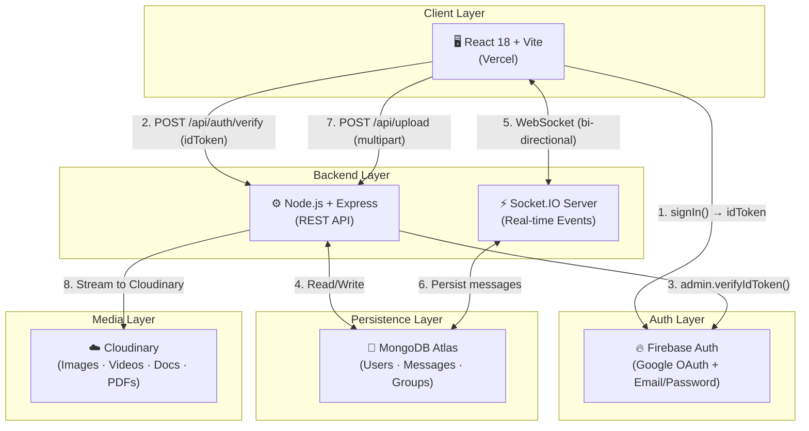
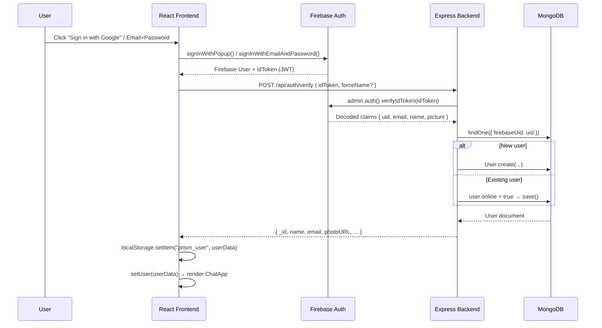
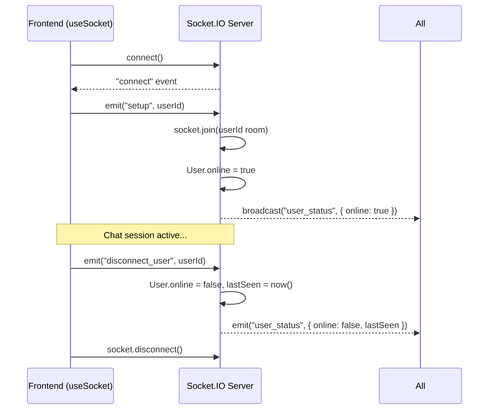
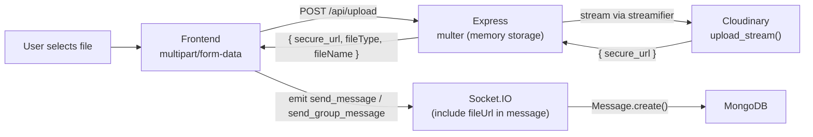
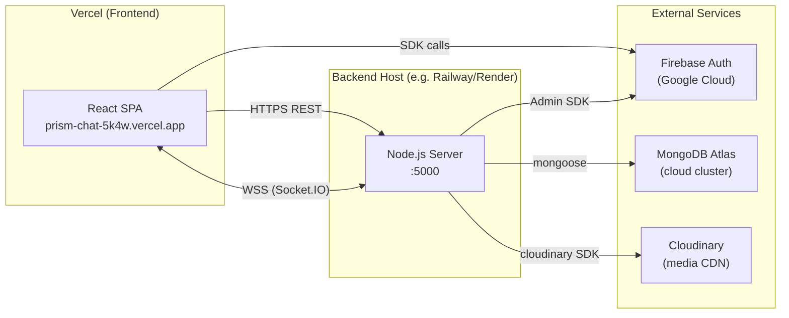

# PrismChat — System Architecture & Design

> A full-stack, real-time chat application with 1-on-1 DMs, group chats, file sharing, emoji reactions, and push notifications.

---

## 1. High-Level Architecture



---

## 2. Technology Stack

| Layer | Technology | Purpose |
|---|---|---|
| **Frontend** | React 18 + Vite | SPA UI framework |
| **Styling** | Tailwind CSS | Utility-first styling |
| **Auth (Client)** | Firebase JS SDK v10 | Sign-in UI, token generation |
| **Auth (Server)** | Firebase Admin SDK | Token verification |
| **Backend** | Node.js + Express | REST API server |
| **Real-time** | Socket.IO v4 | Bidirectional events |
| **Database** | MongoDB + Mongoose | Data persistence |
| **Media CDN** | Cloudinary | File storage & delivery |
| **Frontend Deploy** | Vercel | Static/SPA hosting |
| **Backend Deploy** | (Configurable via `PORT` env) | Any Node host (Railway, Render, etc.) |

---

## 3. Folder Structure

```
firebase migration/
├── frontend/                     # React + Vite SPA
│   └── src/
│       ├── App.jsx               # Root — auth gate + theme provider
│       ├── components/
│       │   ├── auth/             # AuthScreen (login/register/Google)
│       │   ├── chat/             # ChatApp, chat windows, sidebars
│       │   ├── layout/           # Shell, navigation wrappers
│       │   └── ui/               # Reusable atoms (Spinner, Badge…)
│       ├── hooks/
│       │   ├── useAuth.js        # Firebase auth state + localStorage
│       │   ├── useSocket.js      # Socket.IO connection & event map
│       │   ├── useNotifications.js # Browser Push Notification API
│       │   └── useTheme.jsx      # Dark/Light/System theme context
│       └── services/
│           ├── api.js            # Typed REST API client (fetch-based)
│           └── firebase.js       # Firebase SDK init & re-exports
│
└── backend/                      # Node.js + Express server
    ├── index.js                  # Entry: connectDB → HTTP server → Socket.IO
    ├── app.js                    # Express app + CORS + route mounts
    ├── config/
    │   ├── db.js                 # Mongoose connect
    │   ├── socket.js             # Socket.IO init + all event handlers
    │   ├── cloudinary.js         # Cloudinary SDK config
    │   ├── firebaseAdmin.js      # Firebase Admin SDK init
    │   └── mailer.js             # Nodemailer config (optional)
    ├── models/
    │   ├── User.model.js
    │   ├── Message.model.js
    │   └── Group.model.js
    ├── controllers/
    │   ├── auth.controller.js
    │   ├── user.controller.js
    │   ├── message.controller.js
    │   ├── group.controller.js
    │   └── upload.controller.js
    └── routes/
        ├── auth.routes.js
        ├── user.routes.js
        ├── message.routes.js
        ├── group.routes.js
        └── upload.routes.js
```

---

## 4. Data Models

### 4.1 User

```js
{
  firebaseUid: String,   // primary link to Firebase Auth identity
  name:        String,   // display name
  email:       String,   // unique, validated
  photoURL:    String,   // avatar URL (Cloudinary or Google OAuth)
  online:      Boolean,  // live presence flag
  lastSeen:    Date,     // set on disconnect
  chats:       [ObjectId → User]  // DM contact list
}
```

### 4.2 Message

```js
{
  chatId:     String,   // "uid1_uid2" (sorted) | "group_<groupId>"
  senderId:   String,   // MongoDB _id
  receiverId: String,   // MongoDB _id (empty for group messages)
  senderName: String,
  text:       String,
  image:      String,   // Cloudinary URL (legacy image field)
  fileUrl:    String,   // Cloudinary URL for any file
  fileType:   String,   // "image" | "video" | "audio" | "document"
  fileName:   String,   // original filename
  isGroup:    Boolean,
  readBy:     [String], // array of userIds who have read this message
  reactions:  [{ userId: String, emoji: String }],
  replyTo:    { _id, text, image, senderId, senderName } | null,
  createdAt:  Date,     // timestamps: true
  updatedAt:  Date
}
```

### 4.3 Group

```js
{
  name:     String,
  photoURL: String,         // group avatar
  admin:    ObjectId → User,
  members:  [ObjectId → User],
  createdAt: Date,
  updatedAt: Date
}
```

---

## 5. Authentication Flow



> [!NOTE]
> The frontend never directly stores the Firebase idToken. It only stores the resolved MongoDB user object in `localStorage` for session persistence across page refreshes.

---

## 6. REST API Reference

### Auth
| Method | Endpoint | Description |
|---|---|---|
| `POST` | `/api/auth/verify` | Verify Firebase idToken → upsert user → return MongoDB user |

### Users
| Method | Endpoint | Description |
|---|---|---|
| `GET` | `/api/users/search?q=` | Full-text user search by name/email |
| `GET` | `/api/users/:id/chats` | Fetch DM contact list with details |
| `POST` | `/api/users/:id/photo` | Update avatar URL |
| `POST` | `/api/users/:id/name` | Update display name |

### Messages
| Method | Endpoint | Description |
|---|---|---|
| `GET` | `/api/messages/:chatId` | Fetch all messages for a chat (sorted asc) |
| `POST` | `/api/messages/:chatId/read` | Mark all messages as read by userId |
| `GET` | `/api/messages/unread/:userId` | Aggregate unread counts per chatId |
| `POST` | `/api/messages/:messageId/react` | Toggle emoji reaction (add/replace/remove) |
| `GET` | `/api/messages/search/:userId?q=` | Full-text search across all user's chats |

### Groups
| Method | Endpoint | Description |
|---|---|---|
| `POST` | `/api/groups` | Create group (name, adminId, memberIds) |
| `GET` | `/api/groups/user/:userId` | Fetch all groups a user belongs to |
| `GET` | `/api/groups/:groupId` | Fetch single group with member details |
| `PATCH` | `/api/groups/:groupId/rename` | Rename group (admin only) |
| `PATCH` | `/api/groups/:groupId/add` | Add member (admin only) |
| `PATCH` | `/api/groups/:groupId/leave` | Leave group |
| `PATCH` | `/api/groups/:groupId/photo` | Update group avatar URL |

### Upload
| Method | Endpoint | Description |
|---|---|---|
| `POST` | `/api/upload` | Multipart file → Cloudinary → return `{ secure_url, fileType, fileName }` |

---

## 7. Real-Time Event System (Socket.IO)

### Connection Lifecycle



### Emitted Events (Client → Server)

| Event | Payload | Action |
|---|---|---|
| `setup` | `userId` | Join personal room, set user online |
| `send_message` | `{ senderId, receiverId, text, image, fileUrl, fileType, fileName, replyTo }` | Persist to DB → emit to both users |
| `send_group_message` | `{ senderId, groupId, senderName, text, fileUrl, … }` | Persist to DB → emit to group room |
| `join_group` | `groupId` | `socket.join("group_<groupId>")` |
| `mark_read` | `{ chatId, userId }` | Bulk update `readBy` in DB → notify sender |
| `mark_group_read` | `{ chatId, userId }` | Same for group messages |
| `message_reaction` | `{ chatId, message, isGroup }` | Fan-out reaction update |
| `typing` | `{ senderId, senderName, receiverId?, groupId? }` | Forward typing indicator |
| `stop_typing` | `{ senderId, receiverId?, groupId? }` | Clear typing indicator |
| `group_updated` | `{ groupId, group }` | Broadcast group data change |
| `user_left_group` | `{ groupId, userId, group }` | Broadcast + `socket.leave()` |
| `disconnect_user` | `userId` | Set offline, broadcast last seen |

### Received Events (Server → Client)

| Event | Description |
|---|---|
| `receive_message` | New DM message (sent to both sender and receiver rooms) |
| `receive_group_message` | New group message (sent to group room) |
| `push_notification` | `{ title, body, chatId, senderId }` — triggers browser notification |
| `unread_update` | `{ chatId, count }` — real-time badge counter |
| `group_unread_update` | `{ chatId, senderId }` — group badge update |
| `messages_read` | `{ chatId, readBy }` — show read receipts |
| `user_status` | `{ userId, online, lastSeen? }` — presence indicators |
| `reaction_updated` | Full updated message with new reactions array |
| `typing` | `{ senderId, senderName }` — show "typing…" bubble |
| `stop_typing` | Clear typing bubble |
| `group_updated` | Refreshed group object (member add/leave/rename) |

---

## 8. File Upload Pipeline



**Supported file types & Cloudinary resource mapping:**

| MIME Type | Cloudinary `resource_type` | App `fileType` |
|---|---|---|
| `image/*` | `image` | `image` |
| `video/*` | `video` | `video` |
| `audio/*` | `video` | `audio` |
| `application/pdf` | `image` (with `fl_attachment`) | `document` |
| Other | `raw` (with `fl_attachment`) | `document` |

---

## 9. Frontend State Architecture

```
App.jsx
├── ThemeProvider (Context) ← useTheme hook
│   └── AppContent
│       ├── [unauthenticated] → AuthScreen
│       └── [authenticated] → ChatApp
│           └── useSocket(userId, { ...eventHandlers })
│               ├── sendMessage / sendGroupMessage
│               ├── markRead / markGroupRead
│               ├── emitTyping / emitStopTyping
│               └── emitReaction / emitGroupUpdated
```

**Custom Hooks summary:**

| Hook | Responsibility |
|---|---|
| `useAuth` | Firebase sign-in state, `localStorage` session persistence |
| `useSocket` | Socket.IO lifecycle: connect, register all event listeners, expose emitters |
| `useNotifications` | Browser Notification API — request permission, show push notifications |
| `useTheme` | Dark/Light/System theme via `localStorage` + `prefers-color-scheme` |

---

## 10. CORS & Security

- **CORS whitelist** is managed via `ALLOWED_ORIGINS` and `FRONTEND_URL` environment variables (comma-separated) on the backend — same config applied to both Express and Socket.IO.
- **All auth** is handled by Firebase tokens; the backend never stores or issues its own JWT.
- **No auth middleware on most routes** — the current design trusts the client-provided userId. For production hardening, adding token verification middleware per route is recommended.

---

## 11. Deployment Topology



**Environment Variables needed:**

| Variable | Where | Purpose |
|---|---|---|
| `VITE_API_URL` | Frontend | Backend base URL |
| `VITE_FIREBASE_*` | Frontend | Firebase project config (6 keys) |
| `MONGO_URI` | Backend | MongoDB connection string |
| `PORT` | Backend | Server port |
| `ALLOWED_ORIGINS` | Backend | Comma-separated CORS whitelist |
| `FRONTEND_URL` | Backend | Single frontend URL for CORS |
| `CLOUDINARY_CLOUD_NAME` | Backend | Cloudinary account |
| `CLOUDINARY_API_KEY` | Backend | Cloudinary credentials |
| `CLOUDINARY_API_SECRET` | Backend | Cloudinary credentials |
| `FIREBASE_SERVICE_ACCOUNT` | Backend | JSON key for Firebase Admin SDK |

---

## 12. Key Design Decisions

| Decision | Rationale |
|---|---|
| **Firebase Auth + MongoDB** | Offload auth complexity to Firebase; retain full control over app data in MongoDB |
| **Socket.IO for messages** | True bidirectional transport; built-in room abstraction maps perfectly to DM/group chat model |
| **`chatId` as composite key** | `[uid1, uid2].sort().join("_")` ensures deterministic, symmetric chat identification |
| **`readBy` array on messages** | Supports multi-user read receipts natively; works for both DM (2 users) and groups (N users) |
| **Cloudinary via streaming** | Avoids writing files to disk on the server; `streamifier` pipes multer memory buffer directly |
| **`localStorage` session** | Avoids re-validating token on every refresh; user is already verified by backend at login time |
| **Presence via Socket events** | Online/offline state is ephemeral — no polling; `setup` sets online, `disconnect_user` sets offline + `lastSeen` |
